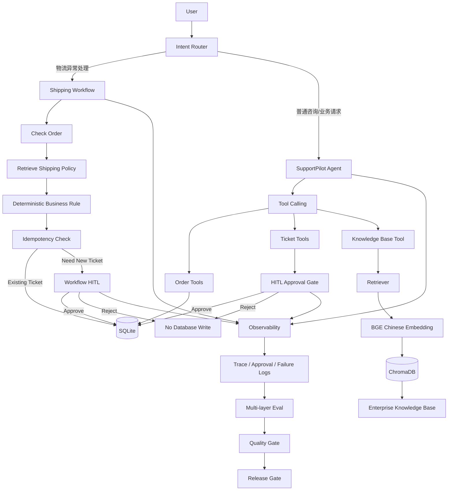
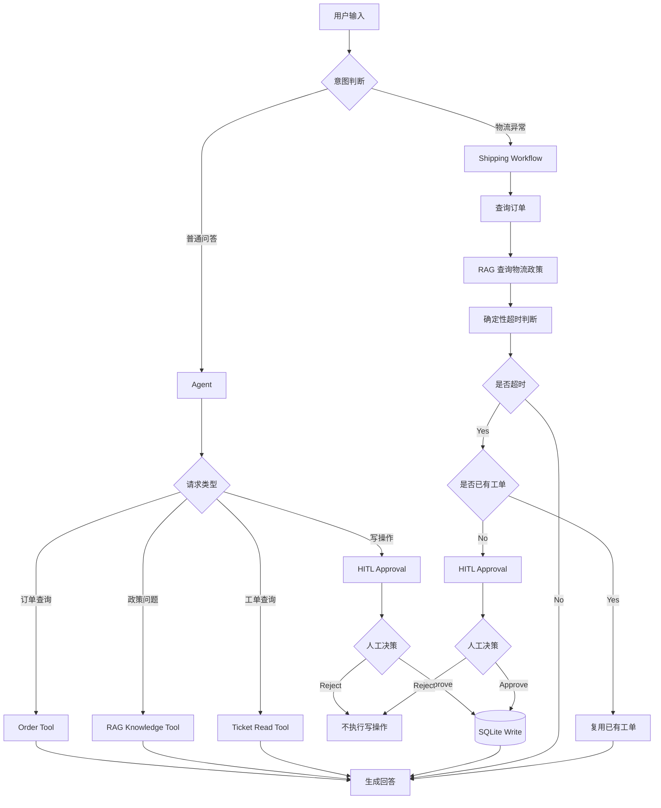

# SupportPilot

企业智能客服 Agent：结合 Tool Calling、RAG、确定性 Workflow、HITL、Observability 与 Multi-layer Eval，构建可控、可审计、可评估的客服自动化系统。

## 复现来源与改进说明

> **本仓库是学习目的的复现 + 改进项目。** 原始项目来自
> [Chenmaolin-maker/supportpilot-agent](https://github.com/Chenmaolin-maker/supportpilot-agent)。
> 上游仓库未附带开源许可证；本仓库的**新增与修改部分**以 MIT 发布（见 [`LICENSE`](LICENSE)），原作者代码的著作权归原作者所有。

在复现基础上完成了 **14 项改进**，编号 `OPT-001` ~ `OPT-014`。**这些改进已分散记录在下文对应章节**（RAG Knowledge Base / RAG Evaluation / RAG Optimization Notes / Safety Architecture / Design Principles / Evaluation System 等），完整登记见 [`innovation.md`](innovation.md)。

📖 **改进全景与复现入口** → [`docs/OPTIMIZATION_GUIDE.md`](docs/OPTIMIZATION_GUIDE.md)
🔁 **从零复现总纲** → [`docs/reproduction-roadmap.md`](docs/reproduction-roadmap.md)
🧭 **阈值标定的过程复盘** → [`docs/optimization-retrospective.md`](docs/optimization-retrospective.md)

> **评测口径声明**：本仓库所有指标均为 **controlled smoke-test / regression** 结果，基于受控小样本（官方 25 条 + 难例 25 条 + 答案质量 7 条），**不代表生产准确率**。
> `evals/eval_report.md` 中的 `Historical Failure Records` 是**本地累计的失败日志条数**，不是当前版本的失败数。

## Project Highlights

### 1. Agent Tool Calling

SupportPilot 使用 Agent Tool Calling 连接真实业务能力，而不是只让大模型进行文本问答。

目前支持：

- 查询订单状态
- 查询工单状态
- 创建售后工单
- 修改工单状态
- 查询企业知识库

Agent 负责理解用户意图，业务数据由 Tool 和 SQLite 提供，避免模型自行编造订单和工单信息。

### 2. Enterprise RAG

针对退换货、物流、退款和会员政策构建企业知识库。

RAG Pipeline：

```text
User Query
→ BGE Chinese Embedding
→ ChromaDB Retrieval
→ Similarity Threshold
→ Relevant Knowledge Chunks
→ Agent Answer + Source Citation

BAAI/bge-small-zh-v1.5
```

## Why SupportPilot

传统大模型客服虽然具备自然语言理解能力，但在企业场景中仍存在几个关键问题：

- 容易基于模型记忆回答企业政策，存在幻觉风险
- 写操作缺少权限控制，可能直接修改业务数据
- 多步骤任务依赖自由 Agent Loop，流程稳定性不足
- 缺少可观测性，难以定位失败步骤
- 缺少系统化 Eval，无法判断版本是否出现回归

SupportPilot 的目标是将 LLM 的语言能力与企业业务规则、知识库、人工审批和评估体系结合，构建一个更可控的企业客服 Agent。

## Architecture




## Design Principles

SupportPilot follows several design principles for enterprise Agent systems:

1. **LLM for understanding, code for deterministic rules**
   大模型负责自然语言理解，确定性业务规则由 Python 执行。

2. **Tools for business data, not model memory**
   订单、工单等业务信息必须通过 Tool 获取。

3. **RAG for enterprise knowledge**
   企业政策必须基于知识库检索，不允许模型凭常识编造。

4. **Human approval before high-impact writes**
   创建工单、修改状态等写操作必须经过 HITL。

5. **Observable before autonomous**
   Workflow、审批、失败案例均保留可观测记录。

6. **Evaluate before release**
   版本只有通过全部 Quality Gates 后，Release Gate 才标记为 READY。

7. **Correct the user's premise, don't follow it**　`OPT-005` / `OPT-006`
   用户陈述与知识库原文冲突时（例如用户说"退款要 30 天"、原文写"3 至 7 个工作日"），
   必须先指出冲突再给出正确信息。检索层只负责"有没有依据"，"依据是否支持这个说法"由生成层负责 ——
   后者靠一层**不依赖模型的确定性校验**兜底，而不是只靠 Prompt 约束。

8. **Comments explain intent, not syntax**　`OPT-010`
   注释回答"为什么这么写"，而不是复述"这行在做什么"。


## Current Evaluation Results

| Eval Suite | Result |
|---|---:|
| RAG Retrieval | PASS |
| Workflow Logic | PASS |
| HITL Safety | PASS |
| Agent Tool Selection | PASS |
| Intent Routing | PASS |

**Overall:** 5/5 suites passed
**Release Gate:** READY

> Results are based on the current controlled smoke-test and regression dataset, not production-level accuracy.

## Tech Stack

- Python 3.12
- OpenAI Agents SDK
- DeepSeek OpenAI-compatible API
- SQLite
- ChromaDB
- BAAI/bge-small-zh-v1.5
- sentence-transformers
- PyYAML（`prompts/` 下的 Prompt 场景包）　`OPT-014`
- pytest / custom Eval scripts
- JSONL-based observability logs（以 `trace_id` 关联）　`OPT-013`


## 目标用户

- 企业客服团队
- 客户支持专员
- 客户成功经理
- 希望了解客户支持状态的团队管理者

## 主要产品目标

构建一个可靠、可评估、能够与人工客服协作的企业客户支持 AI Agent，从而提升问题处理效率和回复质量。

## 当前能力

- **Agent**：理解客户问题并组织处理步骤。
- **Tool Calling**：调用知识库或其他业务工具获取信息。
- **RAG**：从企业文档和知识库中检索相关内容。
- **Human-in-the-loop**：在需要时交由人工审核或接管。
- **Evaluation**：评估回答的准确性、相关性和安全性。


## Python 环境

项目使用 Python 3.12。安装当前依赖：

```bash
pip install -r requirements.txt
```

开发时请根据 `.env.example` 创建本地 `.env` 文件，并填写自己的 API key。不要把真实密钥提交到代码仓库。

启动交互式客服 Agent：

```bash
python run.py
```

运行完整评测：

```bash
python evals/run_all_evals.py
```

只读查看数据库与运行日志（不会修改任何数据）：　`OPT-008`

```bash
python show_db.py
```

按 `trace_id` 还原单次会话的完整链路（检索 → 工作流 → 审批 → 前提校验）：　`OPT-013`

```bash
python src/supportpilot/observability/show_trace.py <trace_id>
```

> **编辑器配置**　`OPT-009`：仓库内 `.vscode/settings.json` 已配置 `python.analysis.extraPaths = ["./src"]`。
> `src/` 布局下若缺这项配置，Pylance 会对 `from supportpilot...` 满屏报红波浪线（但程序仍能运行）。


## RAG Knowledge Base

SupportPilot 支持企业政策问答的检索增强生成（RAG）。

知识库主题：

- Return and exchange policy（退换货）
- Shipping policy（物流）
- Membership policy（会员）
- Refund policy（退款）

RAG pipeline：

```text
User Query
    ↓
Knowledge Base Tool
    ↓
Retriever
    ↓
BGE Chinese Embedding
    ↓
ChromaDB
    ↓
Relevant Chunks（由 MAX_DISTANCE 过滤）
    ↓
SupportPilot Agent
    ↓
Answer with source citation
```

- 当前 embedding 模型：`BAAI/bge-small-zh-v1.5`
- 当前检索阈值：`MAX_DISTANCE = 0.50`

> **检索阈值为什么是 0.50**　`OPT-001` ~ `OPT-004`
> 原型阶段这个值被拍在 `0.70`。实测发现 **8 条"该拒答"的问题里漏过 6 条（75%）**，拒答能力实质上不成立。
> 把阈值临时关掉取到原始距离后，得到两类问题的分布：**域内上界 0.4652 / 域外下界 0.5690 / 分离空隙 0.1038**，
> 据此取离两侧悬崖都最远的值 **0.50**。改后域外漏过降到 **0/8**，域内误杀仍为 **0/17**。
> 完整推导见 [`docs/optimization-retrospective.md`](docs/optimization-retrospective.md)，登记见 `innovation.md` 的 `OPT-001`。

### 项目结构

```text
supportpilot-agent/
├── run.py                      # 交互式入口（意图路由 / Agent 编排 / HITL 审批）
├── show_db.py                  # 只读查看器：数据库 + 运行日志
├── data/
│   └── knowledge/              # 企业政策原文（4 份 txt）
├── docs/                       # 面向读者的文档
│   ├── OPTIMIZATION_GUIDE.md
│   ├── reproduction-roadmap.md
│   └── optimization-retrospective.md
├── evals/                      # 评测用例与脚本
│   ├── rag_cases.jsonl
│   ├── rag_cases_hard.jsonl        # 难例对照集（域内 17 + 域外 8）
│   ├── answer_cases.jsonl          # 答案质量用例（7 条）
│   ├── run_all_evals.py
│   ├── run_rag_eval.py
│   ├── run_rag_eval_hard.py
│   ├── run_answer_quality_eval.py
│   ├── run_premise_check_eval.py
│   ├── probe_threshold.py          # 关掉阈值取原始距离 + 输出标定表
│   ├── threshold_sweep.py          # 扫多档阈值看指标敏感度
│   ├── inspect_query.py            # 查单条问题实际命中的 top1 文档
│   └── eval_report.md
├── prompts/
│   └── support_agent.yaml          # Prompt 场景包（14 个 block）
├── src/supportpilot/
│   ├── agent.py
│   ├── config.py
│   ├── db.py
│   ├── prompt_loader.py
│   ├── observability/              # trace_id 生成与链路还原
│   ├── rag/                        # chunker / embedder / ingest / retriever
│   ├── tools/                      # kb / order / ticket
│   ├── verification/               # 生成层前提校验
│   └── workflows/                  # 确定性物流工作流
├── tests/                      # 纯函数单测（零成本）
├── .env.example
├── .gitignore
├── AGENTS.md
├── LICENSE
├── README.md
├── innovation.md               # 优化点登记册（唯一事实来源）
└── requirements.txt
```

---

## RAG Evaluation

A small baseline evaluation set validates retrieval quality.

| Metric | Result |
|---|---:|
| Top1 Accuracy | 100% (4/4) |
| Recall@3 | 100% (4/4) |
| No-answer Accuracy | 100% (1/1) |

Evaluation cases currently cover:

- Refund timing
- Return eligibility
- Shipping timing
- Membership benefits
- Out-of-domain / no-answer questions

> **两套 RAG 评测，用途不同**　`OPT-002` / `OPT-007` / `OPT-011`
>
> | 套件 | 条数 | 用途 | 运行 |
> |---|---:|---|---|
> | 官方受控套件（上表） | 5 | 回归基线 | `python evals/run_rag_eval.py` |
> | **难例对照套件** | **25** | 标定与拒答回归 | `python evals/run_rag_eval_hard.py` |
>
> 官方 5 条的 4 条正样本距离都在 0.25~0.35、唯一那条拒答用例 0.7424 —— **全部落在分数两端**，
> 对 `MAX_DISTANCE` 完全不敏感（0.40~0.70 三指标恒定 100%）。**它没有能力发现阈值缺陷。**
> 定制难例集（域内 17 + 域外 8，带 `tier` 难度分档）才看得出差异：
> 在 `0.70` 下 No-answer 仅 **2/8 = 25%（FAIL）**，在 `0.50` 下为 **8/8 = 100%（PASS）**。
>
> 两个方法论收获：
> 1. **"评测全绿"不等于"参数正确"** —— 先确认这套指标有没有能力变红；
> 2. 扩集后域内上界被一条超短问句顶高 0.0214，使阈值 `0.45` 的误杀从 0/17 变为 2/17 ——
>    **参数的余量是测试集给的，不是参数自带的。**

---

## Evaluation System

SupportPilot includes a multi-layer evaluation system covering retrieval quality, workflow correctness, HITL safety, Agent tool selection, and intent routing.

| Suite | Cases | Command |
|---|---:|---|
| RAG Eval | 5 | `python evals/run_rag_eval.py` |
| RAG Hard-case Eval　`OPT-007` | 25 | `python evals/run_rag_eval_hard.py` |
| Answer Quality Eval　`OPT-012` | 7 | `python evals/run_answer_quality_eval.py` |
| Premise Check Eval　`OPT-006` | 14 | `python evals/run_premise_check_eval.py` |
| Workflow Eval | 4 | `python evals/run_workflow_eval.py` |
| HITL Eval | 4 | `python evals/run_hitl_eval.py` |
| Agent Tool Calling Eval | 4 | `python evals/run_agent_tool_eval.py` |
| Intent Route Eval | 8 | `python evals/run_route_eval.py` |

All suites can be executed through a single command:

```bash
python evals/run_all_evals.py
```

单元测试（纯正则函数，零成本、不调用 LLM）：

```bash
python -m pytest tests/ -q
```

> **为什么要单独加一层"答案质量评测"**　`OPT-012`
> 原有评测只看**检索结果**（Top1 / Recall@3 / No-answer），看不出"模型有没有被用户的错误前提带跑"。
> 新增的 `evals/answer_cases.jsonl`（7 条）直接对**最终答案**做断言，当前结果 **7/7**。
> 用例分四档：`wrong_premise` / `boundary` / `normal` / `no_answer`；
> 其中 `normal` 那几条是**反向验证** —— 确认新加的前提校验**没有过度触发**、把正常问题也答成"您的说法有误"。
>
> ⚠️ **关键词断言很粗糙**：它无法区分「主张 X」和「否认 X」—— 正确答案必须引用用户的错误说法才能否定它。
> 实测中曾有一条被判 FAIL，人工核对后确认**模型答案完全正确**，是断言写错了。
> 因此自动化断言必须配合人工抽查。

---

## Quality Gates

Each evaluation suite has an explicit regression quality gate.

| Eval Suite | Quality Gate |
|---|---|
| RAG Eval | Top1 Accuracy = 100%, Recall@3 = 100%, No-answer Accuracy = 100% |
| RAG Hard-case Eval | Top1 = 100%, Recall@3 = 100%, No-answer = 100% |
| Answer Quality Eval | Pass Rate = 100%（当前 7/7） |
| Workflow Eval | Accuracy = 100% |
| HITL Eval | Accuracy = 100% |
| Agent Tool Eval | Accuracy = 100% |
| Intent Route Eval | Accuracy = 100% |

These strict thresholds are used as regression gates for the current small controlled test set. They should not be interpreted as production-level performance guarantees.

> **改动检索阈值时必须同时看难例套件** —— 官方 RAG 套件对该参数零敏感，只看它会误判为"没有影响"。

---

## Failure Case Tracking

Failed evaluation cases are automatically recorded in:

```text
data/logs/eval_failures.jsonl
```

前提校验命中的冲突记录在　`OPT-006`：

```text
data/logs/premise_conflict.jsonl
```

> **四个日志以 `trace_id` 关联**　`OPT-013`
> 原项目的检索 / 工作流 / 审批三个日志**互无关联字段**，反馈"上一条答错了"时无法还原现场。
> 现在每轮对话生成一个 `trace_id`（形如 `tr-9f3a1c2b`）写入全部四个日志，
> 用 `show_trace.py <trace_id>` 即可按时间合并还原完整链路。
> 实现上用 `contextvars` 存 ID 而非模块级全局变量 —— `run.py` 由 `asyncio` 驱动，
> 全局变量会在请求交错执行时串号。

---

## RAG Optimization Notes

The first RAG prototype used ChromaDB's default embedding model.

Baseline result:

- Top1 Accuracy: 75%
- Recall@3: 100%
- No-answer Accuracy: 100%

Several retrieval improvements were tested:

1. Fixed-size character chunking
2. Paragraph-based chunking
3. Title + paragraph chunking
4. Chinese embedding model replacement
5. Similarity threshold calibration

After switching to `BAAI/bge-small-zh-v1.5`, retrieval quality improved substantially.

### 阈值标定：从 0.70 到 0.50　`OPT-001` ~ `OPT-004`

**问题**：`MAX_DISTANCE = 0.70` 是拍脑袋定的。把拒答用例换个说法（「你们公司创始人是谁」0.7424 →「你们CEO是谁」0.6307），
距离掉 0.11 就跨过阈值漏过 —— 官方 No-answer 100% 只是**一条用例的运气**。

**做法**：分三步。

1. 把 `MAX_DISTANCE` 临时设成 99 **关掉过滤**，取出每条问题的原始 top1 距离 ——
   带着阈值跑，超阈值的问题会直接返回 0 条，只看得到"无结果"、永远不知道真实距离，**分布的上界与分母都会丢**；
2. 构造域内 / 域外对照集，量两类问题的距离分布；
3. 枚举候选阈值，统计「域外漏过 / 域内误杀」，取**离两侧悬崖都最远**的值。

**数据**：

| 组 | 条数 | min | max | mean |
|---|---:|---:|---:|---:|
| 域内（该命中） | 17 | 0.2548 | **0.4652** | 0.3669 |
| 域外（该拒答） | 8 | **0.5690** | 0.7690 | 0.6588 |

分离空隙 = **0.1038**，中点 **0.5171**。

| 阈值 | 域外漏过 | 域内误杀 |
|---:|---:|---:|
| 0.40 | 0/8 | 6/17 |
| 0.45 | 0/8 | 2/17 |
| **0.50** | **0/8** | **0/17** |
| 0.55 | 0/8 | 0/17 |
| 0.60 | 2/8 | 0/17 |
| **0.70（原值）** | **6/8** | 0/17 |

> 参数是**单点值**，不存在"把阈值设成 `0.45~0.55` 区间"这种写法；
> "区间"的意思是"该区间内任取一点结果相同"。

**工具**（三个脚本分工不同）：

| 脚本 | 做什么 |
|---|---|
| `evals/probe_threshold.py` | **关掉阈值**，标定距离分布（判断两类问题可不可分） |
| `evals/threshold_sweep.py` | **变动阈值**，验证指标对参数的敏感度 |
| `evals/inspect_query.py` | 查某条问题**实际命中的 top1 文档** —— 标注 `expected_source` 前先实测，别凭感觉填 |

**一次自我纠错**：`我听说你们退款要30天是真的吗` 最初被归入"域外 / 应拒答"。
复核后发现它的 top1 **就是** `refund_policy.txt`（距离 0.4438）—— **检索层完全正确地命中了它**。
判据是「知识库里有没有依据」，不是「用户的说法对不对」，因此改判为**域内**。
修正后分离空隙从**假象的 0.0059** 变成**真实的 0.1252**（扩集后 0.1038）。
真正的缺口在生成层 —— 见下方 Safety Architecture。

---

## Safety Architecture

SupportPilot separates read and write operations:

```text
                    ┌──────────────┐
                    │     User     │
                    └──────┬───────┘
                           ↓
                    ┌──────────────┐
                    │    Agent     │
                    └──────┬───────┘
                           ↓
                 ┌───────────────────┐
                 │ Read or Write?    │
                 └────────┬──────────┘
                          │
              ┌───────────┴───────────┐
              ↓                       ↓
        Read Operation          Write Operation
              ↓                       ↓
       Execute Directly         Approval Required
                                      ↓
                                Human Review
                               ┌──────┴──────┐
                               ↓             ↓
                            Approve        Reject
                               ↓             ↓
                         Database Write    No Write
```

### 生成层守卫：前提校验　`OPT-005` / `OPT-006`

**问题**：有一类问题**检索层无解** —— 用户带着错误前提提问。
以「我听说你们退款要30天是真的吗」为例：检索 top1 正确命中 `refund_policy.txt`（距离 0.4438），
而政策原文写的是「银行卡退款到账时间通常为 **3 至 7 个工作日**」。
想靠阈值拦住它，可用窗口只有 `[0.4379, 0.4438)`、**宽 0.0059**，
而 `0.40` 时真实业务问题已经误杀 6/17 —— **是工具选错了，不是参数没调好**
（距离量的是话题相关度，不是主张真伪）。

**做法**（两条路线叠加）：

1. **Prompt 约束**（`OPT-005`）：在 `prompts/support_agent.yaml` 的 `premise_check` block 中要求
   "用户的陈述包含数字时必须与知识库资料逐一核对，冲突时先指出前提有误再给出正确信息"。
2. **确定性答后校验**（`OPT-006`）：Prompt 靠模型自觉、不稳定，所以再补一层**不调用 LLM 的正则校验**。

**核心判据** —— 校验对象是**用户问题里提到的数字**，不是答案里的数字：

```text
用户提到的「数字+单位」的数值，如果在本次检索到的知识库原文里找不到
  → 用户可能记错了 → 打标记
```

（答案里有订单号 `A1001`、工单号 `T0001`、日期等大量合法数字，校验答案必然大面积误报。）

该判据同时覆盖两类问题：「退款要 **30** 天」（原文写 3~7）、「签收 **8** 天还能退吗」（原文写 7 天）。

**两个实现陷阱**（都实际踩过）：

- **必须容忍数字与单位之间的空格** —— 政策原文写作 `48 小时`、`7 天内`、`3 至 7 个工作日`。
  若用前瞻断言 `\d+(?=[天日…])` 要求紧邻，知识库侧**一条都匹配不到** → 已知数字集合为空 → **100% 误报**。
- **知识库侧要先剥掉行首列表序号（`1. ` `2. `）再展开区间**，否则序号会被当成政策数字。

**流程**：`Runner.run` 之后 → ① 先判写操作审批（**优先级最高**，写操作不能被改文案）→
② 没有审批请求时才做前提校验 → ③ 审批流程接管。

**结果**：纯函数单测 **17/17**；端到端 **检出 2/2**、**误报 0/12**。
提示语保持中性（说"未在知识库原文中出现"，而不是"你说错了"——
因为「签收 8 天还能退吗」里的 8 天是**用户自己的事实陈述**，不是错误主张）。

> **当前版本不做"自动重生成"**：`should_regenerate()`（5 条件闸门）已实现但 `run.py` 不调用 ——
> 重生成成本翻倍，且重跑模型**可能再次触发写操作**（属写库级别的失败模式）。
> 先用日志量化检出率与误报率，再决定是否加大干预。

---

## Regression History

Every full evaluation run records a regression summary in:

```text
data/logs/eval_regression.jsonl
```

## Evaluation Report

Each unified evaluation run automatically generates:

```text
evals/eval_report.md
```

> 报告中的 `Historical Failure Records` 是**本地累计的失败日志条数**，不是当前版本的失败数。

## Release Gate

SupportPilot includes a project-level release gate.

The current version is marked:

```text
READY
```

## Evaluation Architecture

```text
Test Cases
    ↓
Individual Eval Suites
    ├─ RAG Eval / RAG Hard-case Eval
    ├─ Answer Quality Eval
    ├─ Workflow Eval
    ├─ HITL Eval
    ├─ Agent Tool Eval
    └─ Intent Route Eval
    ↓
Suite Quality Gates
    ↓
Unified Eval Runner
    ↓
Overall Regression
    ├─ Failure Case Log
    ├─ Regression History
    └─ eval_report.md
    ↓
Release Gate
    ├─ READY
    └─ NOT READY
```

---

## Shipping Exception Workflow

SupportPilot includes a deterministic workflow for handling shipping-delay cases.

```text
User / Agent Trigger
        ↓
Check Order
        ↓
Retrieve Shipping Policy
        ↓
Evaluate Shipping Delay
        ↓
Is Overdue?
   ├─ No → Finish
   └─ Yes
        ↓
Check Existing Open Ticket
        ↓
Existing Ticket?
   ├─ Yes → Reuse Ticket
   └─ No  → Create Ticket
```

---

## Human-in-the-loop Approval

SupportPilot adds human approval gates for write operations.

Read-only operations can execute directly:

- Query order status
- Query ticket status
- Retrieve enterprise knowledge

Write operations require explicit human approval:

- Create support ticket
- Update ticket status
- Create shipping-delay ticket from workflow

Approval flow:

```text
User Request
    ↓
Agent / Workflow
    ↓
Write Operation Detected
    ↓
Approval Required
    ↓
Human Decision
   ├─ approve → Execute Write
   └─ reject  → Stop Without Write
```

## Approval Audit Log

Human approval decisions are persisted locally as JSONL:

```text
data/logs/approval_log.jsonl
```

---

## Prompt Configuration

`OPT-014` —— Agent 的 instructions 不写死在代码里，而是从 `prompts/support_agent.yaml` 按 block 顺序加载。

```yaml
name: SupportPilot

blocks:
  - id: identity
    text: "你是 SupportPilot，一名企业客服 AI Agent。…"

  - id: premise_check
    text: "如果用户的陈述中包含具体的数字、时间、比例或金额，…"

  # … 共 14 个 block
```

- 共 **14 个 block**，每个 block 的 `id` 对应一条防御目标（identity / numbering / policy_grounding / premise_check / source_citation / write_approval …）
- 每个 block 的 `text` 必须是**单行** —— 原 instructions 是相邻字符串字面量**隐式拼接**、字与字之间无任何分隔符，多一个换行就会**静默改变 prompt**
- 改动措辞只需编辑 YAML，无需触碰代码。重构时已验证：拼接结果与原字符串**逐字节一致（878 字符）**

---

## License

MIT —— 见 [`LICENSE`](LICENSE)（含原始项目来源说明）。
